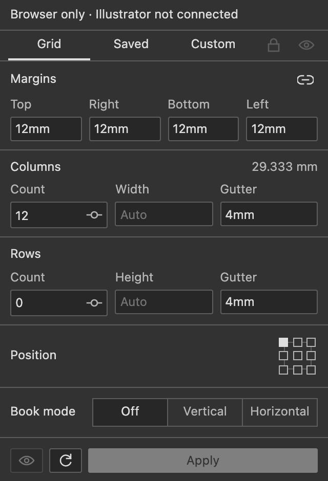
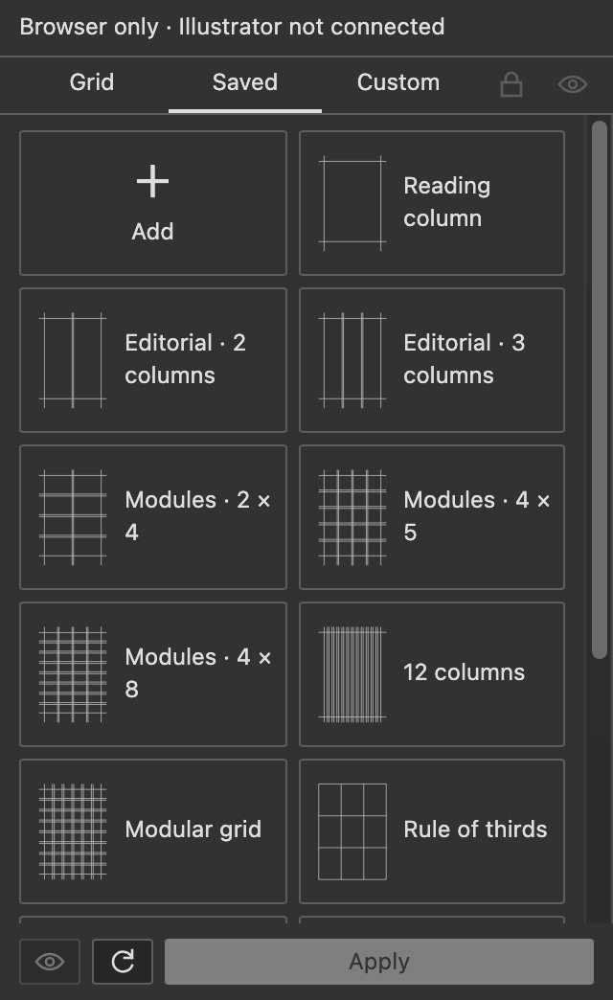
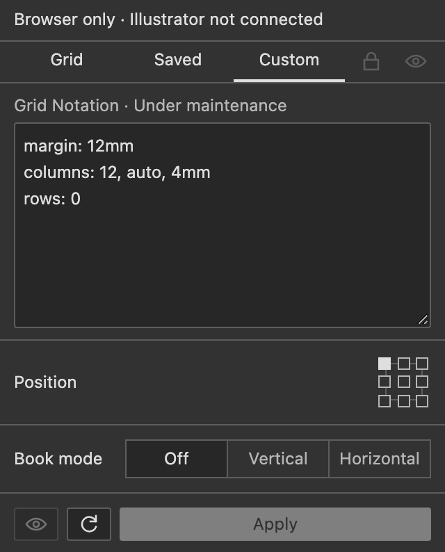

<div align="center">
  
  <h1>gridloom</h1>
  <p>This plugin was developed with Codex.</p>
  <p>A compact panel for drawing grids and guides in Adobe Illustrator and InDesign.</p>
  <p><sub>CEP 12 &nbsp; / &nbsp; Illustrator &nbsp; / &nbsp; GPL-3.0</sub></p>
  <p><a href="README.md">中文</a> · <b>English</b> &nbsp; · &nbsp; <a href="docs/notation.md">Grid Notation</a></p>
</div>

---

## From objects to grids

Select objects to use their bounds, or leave the selection empty to use the active artboard. Enter your dimensions and generate.

| Grid | Actions | Presets |
| :--- | :--- | :--- |
| Margins, rows, columns, gutters, alignment | Scope replacement and book center guides | 13 built-in design grids |
| Fixed sizes, percentages, mixed units | One group per generation, named after its artboard | Save, edit, import, export |
| Variables, flexible space, repeated patterns | Layer locking and visibility | Reading columns, editorial layouts, modular grids |

The panel follows Illustrator's language, font, and theme, with grayscale icons. No hover tooltips or persistent counts; text appears only for errors.

Enter counts directly or click the slider icon to adjust them. Enable live preview with the bottom eye button before adjusting parameters. Locking the layer turns live preview off. **Apply** keeps the result. Book mode repeats the same settings across left/right or top/bottom pages, with a central dividing guide. Press ↑/↓ in dimension fields to add/subtract 1 while retaining the unit.

## Interface

Browser screenshots of the current build. Document actions run inside Adobe applications.

<table><tr><td valign="top"></td><td valign="top"></td><td valign="top"></td></tr></table>

## Install

Download the signed `gridloom-0.5.0.zxp` from [Release 0.5.0](https://github.com/Minuszh/gridloom/releases/tag/v0.5.0), install with a CEP ZXP installer, and open gridloom from Window → Extensions.

Uses CEP 12, with a manifest range of Illustrator 29.5.1–30.x. The InDesign manifest range is 20–21.x. Selected native operations have been tested on macOS Apple Silicon / Illustrator 30.8.2 and InDesign 21.6. Save/reopen restoration and the live-preview crash fix still need native verification.

<details>
<summary>Install from source</summary>

Requires Node.js 22 or later. No dependency installation is needed.

```sh
npm run build
npm run install:dev
```

Unsigned local builds use CEP debug mode. See [testing and local installation (Chinese)](docs/testing.md).

</details>

## Quick notes

- **Book mode**: choose left/right or top/bottom pages. Split the scope equally and repeat the grid on each page; margins, percentages, rows, and columns apply per page.
- Enter dimensions such as `10px`, `3mm`, or `5%`. Bare numbers follow document ruler units. `1 px = 1 pt`.
- A count of `0` retains margin guides. Leave the count blank and enter a fixed size to fill the scope.
- Each generation creates a group inside the `gridloom` layer. Apply replaces the existing grid for the current scope and keeps the artboard name.
- Lock and eye buttons affect only the `gridloom` layer. Bright means locked / visible; gray means unlocked / hidden.
- Applied grids store their parameters in the document. Save the document to retain them; the first scope read in a new session restores them. Switching artboards within a session preserves your inputs. Older grids need to be applied again.
- **InDesign (experimental)** imports page margins and columns and offers a page layout grid preset. Live preview is unavailable; native guides extend across the page.
- **Custom notation is under maintenance.** Generated keywords use English; the interface follows the host language.
- Explore the [notation examples (Chinese)](docs/notation.md) and [changelog](CHANGELOG.md).

## License

[GNU GPL v3.0](LICENSE) · `GPL-3.0-only`

You may use, modify, and distribute it, including commercially. Distribute modified versions with corresponding source under GPL-3.0. Private modifications do not require public release.
