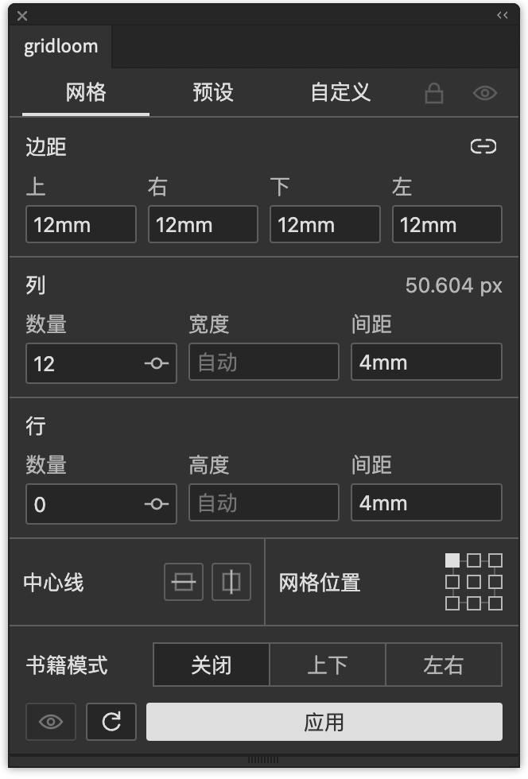
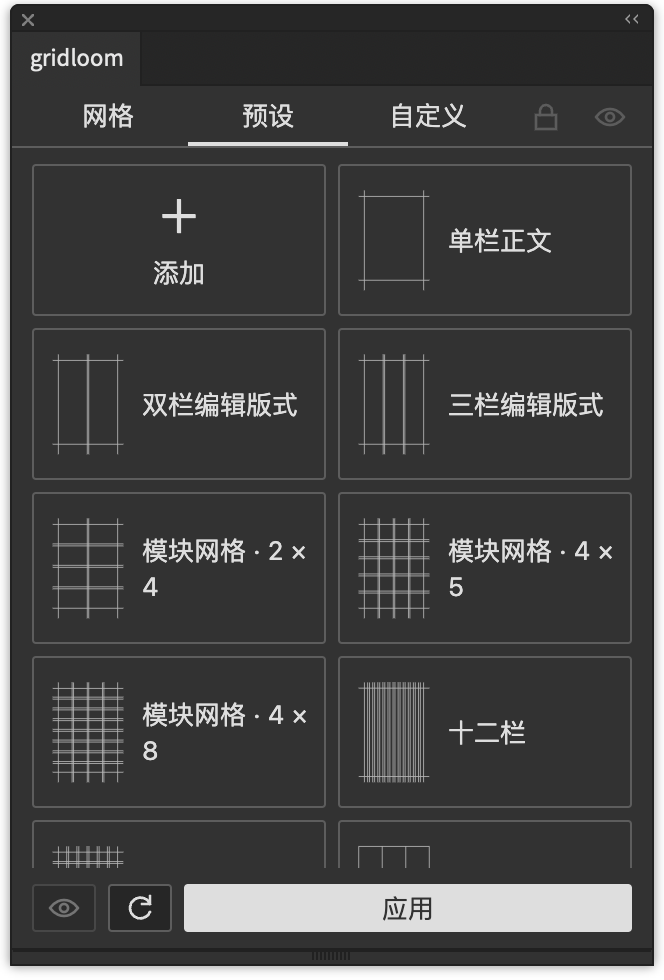
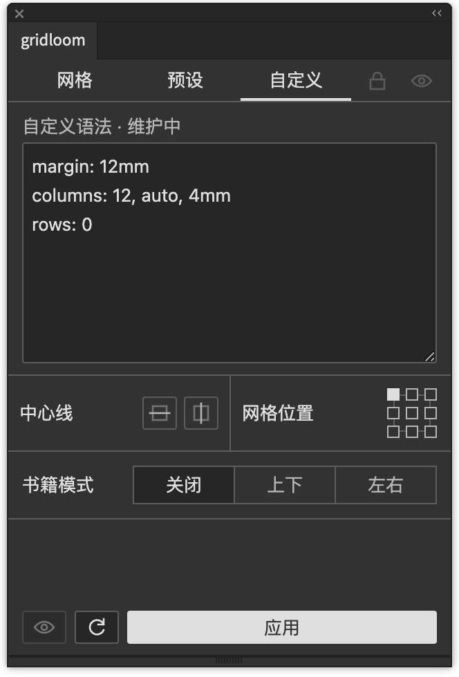

  
  <h1>gridloom</h1>
  
本插件使用 Codex 完成开发。

  
在 Adobe Illustrator 与 InDesign 中，按对象或页面绘制网格与参考线。

  
Illustrator · InDesign · CEP 12 · GPL-3.0

  
<a href="README.md">中文</a> · <a href="README.en.md">English</a>

## 界面

<table>
  <tr><th>网格</th><th>预设</th><th>自定义</th></tr>
  <tr>
    <td valign="top"></td>
    <td valign="top"></td>
    <td valign="top"></td>
  </tr>
</table>

以上为 Illustrator 实机截图。中英文文档共用这组中文截图；面板语言自动跟随宿主。

## 从一个范围开始

选中对象，就以对象边界为范围；没有选区时，Illustrator 使用当前画板，InDesign 使用当前页面。填写边距、列数、行数和间距，点击 **应用**。

- **网格**：支持自动宽高、固定尺寸、百分比与混合单位。数量为 `0` 时只保留该方向的边距线；数量留空并填写固定宽高时自动填满。
- **中心线与网格位置**：水平、垂直中心线可分别开启；九宫格决定固定尺寸网格在范围中的位置。
- **书籍模式**：把当前范围等分为左右或上下两页，分别绘制网格，并添加装订中线。左右双页显示「上、下、内、外」，上下双页显示「左、右、内、外」；内边距始终朝向装订线。
- **实时预览**：点击底部眼睛，再输入参数或展开数量滑条。点击 **应用** 保留结果；预览尚未应用时关闭眼睛，恢复预览前的网格。
- **预设**：内置 13 个版式起点，包括正文栏、模块网格、三分法、黄金比例与基线。选择后自动回到网格页；自己的设置可以保存、编辑及通过 JSON 导入导出。
- **自定义**：打开时将当前网格转换成英文简写。此功能仍标注维护中，写法见 [语法说明](docs/notation.md)。

尺寸可直接输入 `12mm`、`8pt`、`5%`，不写单位时使用文档标尺单位。尺寸框按 ↑ / ↓ 增减 1 并保留单位；边距右侧的链条控制四个可见边距是否联动。

## 参考线与参数保存

应用会替换当前范围已有的 gridloom 网格，保留手动画的参考线。Illustrator 在 `gridloom` 图层内按范围分组；InDesign 使用同名图层内的原生页面参考线。InDesign 参考线延伸到整页，不按对象或半页裁切。

顶部锁和眼睛控制 `gridloom` 图层的锁定、显示；底部眼睛控制实时预览。锁定图层会先保留当前预览，再关闭预览。切换画板或页面不会覆盖已填参数；应用后的参数随文档保存，新会话首次读取对应范围时恢复。

InDesign 首次读取当前页的边距和分栏，并在预设中提供「当前页边距与分栏」「当前页版面字格」。两个软件共用同一套面板、中心线、书籍模式和预览操作。

## 安装

从 [v0.5.0 测试版](https://github.com/Minuszh/gridloom/releases/tag/v0.5.0) 下载签名 `gridloom-0.5.0.zxp`，用支持 CEP 的 ZXP 安装器安装，重启软件，在 **窗口 → 扩展功能 → gridloom** 中打开。签名包不需要开启开发模式。同一包用于 Illustrator 和 InDesign。

当前版本为 `0.5.0`，以 Pre-release（测试版）分发。源码安装及 macOS / Windows 路径见 [安装说明](docs/installing.md)。

| 宿主 | 清单允许范围 | 当前实机测试环境 |
| --- | --- | --- |
| Illustrator | 29.5.1–30.x | macOS Apple Silicon / 30.8.2 |
| InDesign | 20.x–21.x | macOS Apple Silicon / 21.6.0 |

Windows 和范围内其他版本尚未实机验证。具体检查记录见 [测试说明](docs/testing.md)。

## 文档

[安装](docs/installing.md) · [语法](docs/notation.md) · [测试](docs/testing.md) · [打包签名](docs/releasing.md) · [更新记录](CHANGELOG.md)

## 许可

[GNU GPL v3.0](LICENSE) · `GPL-3.0-only`
