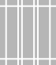

<div align="center">
  
  <h1>gridloom</h1>
  <p>本插件使用 Codex 完成开发。</p>
  <p>为 Adobe Illustrator 绘制网格与参考线的紧凑面板。</p>
  <p><sub>CEP 12 &nbsp; / &nbsp; Illustrator &nbsp; / &nbsp; GPL-3.0</sub></p>
  <p><b>中文</b> · <a href="README.en.md">English</a> &nbsp; · &nbsp; <a href="https://github.com/Minuszh/gridloom/releases">下载安装包</a></p>
</div>

---

## 从对象到网格

选中对象，按对象边界生成；没有选区，就使用当前画板。输入尺寸，点击生成。

| 网格 | 操作 | 预设 |
| :--- | :--- | :--- |
| 边距、行列、间距与对齐 | 追加、替换、边界线与中心线 | 13 个内置设计网格 |
| 固定尺寸、百分比与混合单位 | 每次生成独立分组，以画板名称命名 | 保存、编辑、导入与导出 |
| 变量、弹性空间与重复语法 | 图层锁定、显示与范围清理 | 单栏、编辑版式、模块网格等 |

界面跟随 Illustrator 的语言、字体与主题，使用灰度图标。没有悬停提示和常驻计数，只有出错时显示文字。

数量可以直接输入，也可点击右侧滑条图标展开调整。开启 **实时编辑** 后，画布随参数更新；点击 **应用** 保留，点击 **取消** 恢复。左右／上下双页使用同一套参数。

## 安装

1. 从 [Releases](https://github.com/Minuszh/gridloom/releases) 下载 `gridloom-0.3.14.zxp`。
2. 将文件拖入 [ZXP/UXP Installer](https://aescripts.com/learn/zxp-installer/)。
3. 重启 Illustrator，在 **窗口 → 扩展功能 → gridloom** 中打开。

使用 CEP 12，清单支持 Illustrator 29.5.1–30.x。目前在 macOS Apple Silicon / Illustrator 30.8.2 上完成部分实机测试。

<details>
<summary>从源码安装</summary>

需要 Node.js 22 或更新版本，无需安装依赖。

```sh
npm run build
npm run install:dev
```

未签名开发版需启用 CEP 开发模式，详见 [测试与本地安装](docs/testing.md)。

</details>

## 使用小记

- **书籍模式**：在「位置与设置」选择左右双页或上下双页，当前范围等分成两页，每页绘制同一套网格；边距、百分比和行列按单页计算。
- 尺寸直接写 `10px`、`3mm` 或 `5%`；不写单位时，跟随文档标尺单位。`1 px = 1 pt`。
- 行列数量填 `0`，仍保留边距线；留空并填写固定尺寸，会自动填满。
- 每次生成都在 `gridloom` 图层下建立一组。同一画板可以有多组，名称保持为画板名。
- 锁和眼睛仅控制 `gridloom` 图层。亮色表示锁定 / 显示，灰色表示解锁 / 隐藏。
- 自定义网格写法见 [语法与示例](docs/notation.md)，版本变化见 [更新记录](CHANGELOG.md)。

## 开源协议

[GNU GPL v3.0](LICENSE) · `GPL-3.0-only`

可以使用、修改和分发，包括商业用途。分发修改版时，提供对应源码，并继续使用 GPL-3.0；自己修改自用不要求公开。
