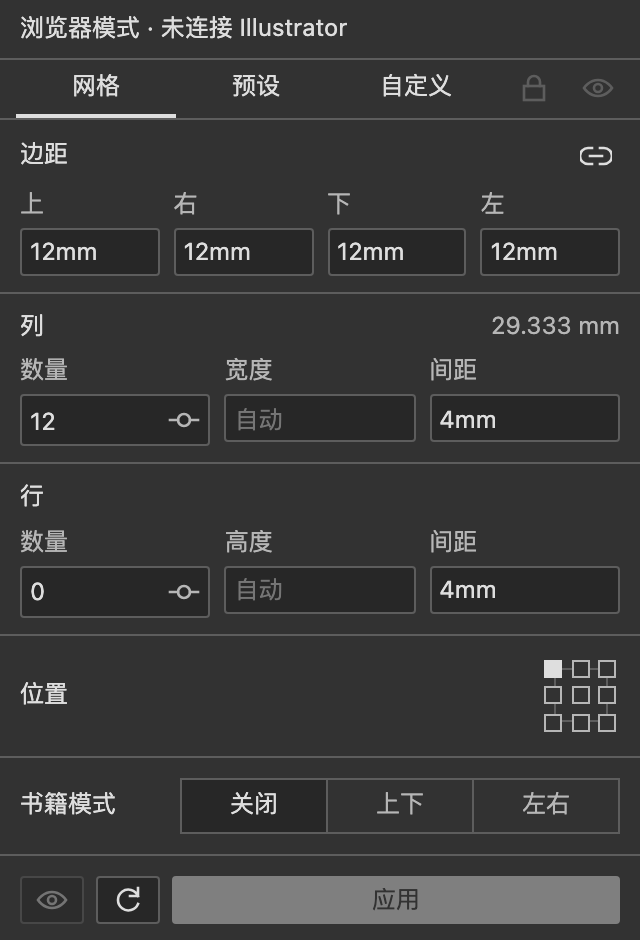
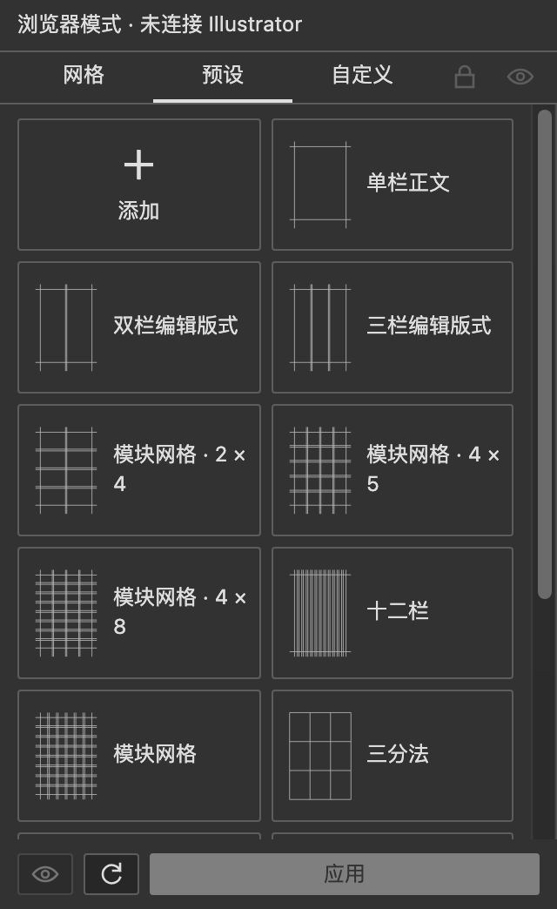
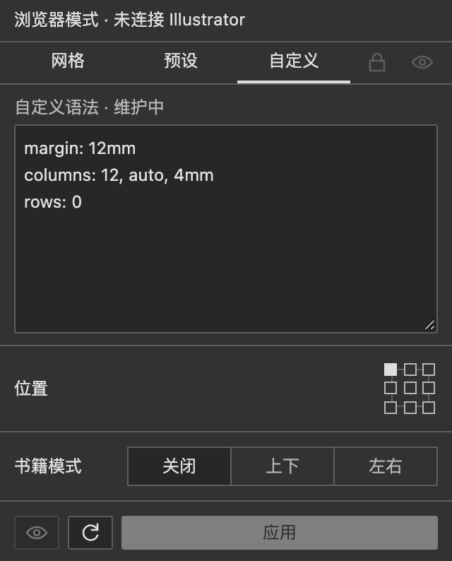

<div align="center">
  
  <h1>gridloom</h1>
  <p>本插件使用 Codex 完成开发。</p>
  <p>为 Adobe Illustrator 与 InDesign 绘制网格和参考线的紧凑面板。</p>
  <p><sub>CEP 12 &nbsp; / &nbsp; Illustrator &nbsp; / &nbsp; GPL-3.0</sub></p>
  <p><b>中文</b> · <a href="README.en.md">English</a> &nbsp; · &nbsp; <a href="docs/notation.md">Grid Notation</a></p>
</div>

---

## 从对象到网格

选中对象，按对象边界生成；没有选区，就使用当前画板。输入尺寸，点击生成。

| 网格 | 操作 | 预设 |
| :--- | :--- | :--- |
| 边距、行列、间距与对齐 | 当前范围替换、书籍中线 | 13 个内置设计网格 |
| 固定尺寸、百分比与混合单位 | 每次生成独立分组，以画板名称命名 | 保存、编辑、导入与导出 |
| 变量、弹性空间与重复语法 | 图层锁定与显示 | 单栏、编辑版式、模块网格等 |

界面跟随 Illustrator 的语言、字体与主题，使用灰度图标。没有悬停提示和常驻计数，只有出错时显示文字。

数量可以直接输入，也可点击右侧滑条图标展开调整。点击底部眼睛开启实时预览，再调整参数；点击 **应用** 保留。锁定图层会关闭实时预览。左右／上下双页使用同一套参数，并添加中间分隔参考线。尺寸框按 ↑／↓ 增减 1，保留输入的单位。

## 界面

以下为当前构建的浏览器界面截图，文档操作在 Adobe 软件中使用。

<table><tr><td valign="top"></td><td valign="top"></td><td valign="top"></td></tr></table>

## 安装

从 [0.5.0 Release](https://github.com/Minuszh/gridloom/releases/tag/v0.5.0) 下载签名安装包 `gridloom-0.5.0.zxp`，使用 CEP ZXP 安装器安装，然后在软件的「窗口 → 扩展功能」中打开 gridloom。

使用 CEP 12，清单支持 Illustrator 29.5.1–30.x。InDesign 清单范围为 20–21.x。在 macOS Apple Silicon / Illustrator 30.8.2、InDesign 21.6 上完成部分原生操作测试。保存重开恢复尚未完成实机验收，实时预览的崩溃修复仍待验证。

<details>
<summary>从源码安装</summary>

需要 Node.js 22 或更新版本，无需安装依赖。

```sh
npm run build
npm run install:dev
```

未签名开发版需启用 CEP 开发模式，详见 [测试与本地安装](docs/testing.md)。

</details>

## 使用小记

- **书籍模式**：选择左右双页或上下双页，当前范围等分成两页，每页绘制同一套网格；边距、百分比和行列按单页计算。
- 尺寸直接写 `10px`、`3mm` 或 `5%`；不写单位时，跟随文档标尺单位。`1 px = 1 pt`。
- 行列数量填 `0`，仍保留边距线；留空并填写固定尺寸，会自动填满。
- 每次生成都在 `gridloom` 图层下建立一组。应用会替换当前范围的旧网格，组名保持为画板名。
- 锁和眼睛仅控制 `gridloom` 图层。亮色表示锁定 / 显示，灰色表示解锁 / 隐藏。
- 新版网格会记录参数。点击应用后保存文档，下次新会话首次读取该范围时恢复；会话内切换画板不覆盖输入。旧网格需重新应用一次。
- **InDesign（测试支持）**：首次读取页边距和分栏，提供当前页版面字格预设；暂不支持实时预览，参考线延伸至整页。
- **自定义语法维护中**：生成的关键词固定为英文，界面仍自动匹配中英文。
- 自定义网格写法见 [语法与示例](docs/notation.md)，版本变化见 [更新记录](CHANGELOG.md)。

## 开源协议

[GNU GPL v3.0](LICENSE) · `GPL-3.0-only`

可以使用、修改和分发，包括商业用途。分发修改版时，提供对应源码，并继续使用 GPL-3.0；自己修改自用不要求公开。
